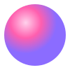

<div align="center">



# 🧠 BrainDeck

**Una mesa de trabajo web para crear y aprender.**
Herramientas para artistas, autodidactas y creativos, todo dentro de tu navegador.

[Demo en vivo](https://gvpv12.github.io/braindeck/) · [Herramientas](#herramientas) · [Empezar](#empezar) · [English](#english)


</div>

---

## Índice

- [Qué es](#qué-es)
- [Herramientas](#herramientas)
- [Empezar](#empezar)
- [Inteligencia artificial](#inteligencia-artificial)
- [Privacidad](#privacidad)
- [Arquitectura](#arquitectura)
- [Añadir una herramienta](#añadir-una-herramienta)
- [Créditos](#créditos)

## Qué es

BrainDeck reúne en un solo lugar más de 20 herramientas que normalmente estarían repartidas entre webs con anuncios, apps de pago y servicios que suben tus archivos a servidores ajenos. Es una web **estática**: HTML, CSS y JavaScript sin compilación, sin backend y sin cuentas. Todo se procesa en tu dispositivo.

- **Cada herramienta tiene su propio enlace** (`index.html#/ruta`) para compartirla directamente.
- **Organizable:** se agrupan por categoría y puedes reordenarlas o moverlas de categoría arrastrando.
- **Tres estilos visuales:** Neo pixel (neobrutalista), Cosmos (glass oscuro) y Frost (minimal).
- **Bilingüe:** español por defecto e inglés desde Ajustes.
- **Responsive:** menú lateral en escritorio y barra inferior en móvil.

## Herramientas

### Estudio

| Herramienta | Ruta | Descripción |
|---|---|---|
| Capturas → notas | `#/notas` | OCR de capturas que separa el texto importante de la interfaz y lo convierte en notas. Modo local, IA local o Claude. |
| Crear plan de estudios | `#/plan` | De una lista de temas, libros o videos a un plan de estudio y evaluación con calendario `.ics` a la hora exacta. |
| Libro → test | `#/test` | Tests desde PDF, EPUB o TXT, con repaso espaciado (Leitner) y enlace para compartir. |
| Reto de 30 días | `#/reto` | Una tarea diaria para dibujo, piano, 3D, animación, idiomas, programación, escritura o un curso desde tu plan de estudios. |
| Coach de inglés hablado | `#/ingles` | Te grabas, Whisper transcribe y la IA corrige gramática, vocabulario, fluidez y posibles fallos de pronunciación. |
| Temporizador de foco | `#/foco` | Acceso a [Focus Time Is Now](https://focustimeisnow.netlify.app/). |

### Imágenes y arte

| Herramienta | Ruta | Descripción |
|---|---|---|
| Marca de agua | `#/marca-agua` | Marcas en lote con metadatos de autor (XMP, EXIF, PNG iTXt) y señal de exclusión de entrenamiento de IA. |
| Convertir y redimensionar | `#/convertir` | PNG, JPG, WebP y AVIF en lote, con reescalado de alta calidad. |
| Quitar fondo | `#/quitar-fondo` | Segmentación con IA en el navegador: PNG transparente, fondo de color o sticker. |
| Generador de paletas | `#/paletas` | Desde un color, una foto o una palabra. Exporta a Procreate, Adobe (`.ase`), GIMP/Krita (`.gpl`), Blender y CSS. |
| Ideas para crear | `#/ideas` | Ideas por formato (ilustración, post, 3D, cómic…) a partir de semillas: tema, vibe, estética, color, animal o imagen. |
| Art Unblock | `#/art-unblock` | Frases surrealistas al azar, o con tus semillas, para vencer el bloqueo creativo. |
| Gesture drawing | `#/gesture` | Sesiones de poses cronometradas con tus referencias o fotos libres de Wikimedia Commons. |

### Utilidades

| Herramienta | Ruta | Descripción |
|---|---|---|
| Unir PDFs | `#/unir-pdf` | Combina PDFs e imágenes, elige rangos de páginas y gíralas. |
| Editar PDF | `#/editar-pdf` | Reordena, gira, elimina y divide páginas, numéralas, firma y comprime. |
| Descargar videos | `#/descargar-video` | Genera el comando exacto de [yt-dlp](https://github.com/yt-dlp/yt-dlp) para la calidad y el formato elegidos, sin webs de descarga inseguras. |
| Generar subtítulos | `#/subtitulos` | SRT y VTT con Whisper en el navegador, editables y traducibles con IA. |
| Generador de QR | `#/qr` | Enlaces, WiFi, contacto o WhatsApp, con estilo de puntos, colores, degradado y logo. PNG y SVG. |

### Dinero

| Herramienta | Ruta | Descripción |
|---|---|---|
| Calculadora de comisión | `#/comision` | Muestra la ecuación, el valor a restar y el valor final; o cuánto cobrar para recibir una cantidad neta. |
| Plan de ahorro | `#/ahorro` | Asistente paso a paso con gráficas, hitos, viabilidad y calendario de aportes. |

### Extras

| Herramienta | Ruta | Descripción |
|---|---|---|
| Minijuegos | `#/juegos` | Morse con sonido, quiz, ahorcado, dibujo ASCII, historia interactiva y quiz de países. |
| Decision Log | `#/decisiones` | Historial de cálculos y planes guardados. |
| Ajustes | `#/ajustes` | Idioma, estilo, IA y copia de seguridad de tus datos. |

## Empezar

**Online:** abre la [demo](https://gvpv12.github.io/braindeck/).

**En local:**

```bash
git clone https://github.com/GVPV12/braindeck.git
cd braindeck
npx serve .            # o: python -m http.server
```

También funciona con doble clic en `index.html`. Aun así, se recomienda servirlo por HTTP: los modelos de IA solo se guardan en caché en `http(s)://`.

**Publicar:** en GitHub Pages, Netlify o Vercel, tal cual, sin configuración.

> La primera vez se necesita conexión para cargar librerías y modelos desde CDN.

## Inteligencia artificial

La IA es opcional y tiene tres niveles:

| Nivel | Qué usa | Requisitos |
|---|---|---|
| Sin IA | OCR, heurísticas y bancos de palabras locales | Ninguno |
| IA local | Gemini Nano (integrado en Chrome) o [WebLLM](https://github.com/mlc-ai/web-llm) con Qwen 2.5 1.5B; Whisper y segmentación con [Transformers.js](https://github.com/huggingface/transformers.js) | Navegador con WebGPU (Chrome o Edge recientes) |
| Claude | API de Anthropic | Tu API key en Ajustes; solo se envía a `api.anthropic.com` |

## Privacidad

- No hay servidor, analítica ni cuentas.
- Imágenes, PDFs, audios y notas se procesan en el navegador.
- Los datos viven en `localStorage` y se pueden exportar o importar desde Ajustes. La API key nunca se exporta.

## Arquitectura

```
braindeck/
├── index.html        Shell, menú y carga de scripts
├── css/app.css       Temas (neo, cosmos, frost) y componentes
├── img/              Logo y banners del inicio
└── js/
    ├── core.js       Router por hash, almacenamiento, UI, IA y categorías
    ├── i18n.js       Traducción de la interfaz al inglés
    └── *.js          Una herramienta por archivo
```

- **Sin build:** scripts clásicos que funcionan incluso desde `file://`.
- **Librerías bajo demanda:** cada librería pesada se carga solo cuando una herramienta la necesita.
- **Router por hash:** cada pantalla devuelve su propia función de limpieza.

## Añadir una herramienta

```js
// js/mi-herramienta.js
BD.tool({
  path: '/mi-herramienta',
  cat: 'estudio',                 // estudio | creativo | media | dinero
  title: 'Mi herramienta',
  icon: BD.icon('bulb'),
  colors: ['#fff07a', '#ffb703'],
  desc: 'Qué hace, en una línea.',
  render(view) {
    const body = BD.win(view, { title: BD.L('Mi herramienta', 'My tool') });
    body.innerHTML = '<p>Hola</p>';
  },
});
```

Después, añade `<script src="js/mi-herramienta.js"></script>` en `index.html`.

## Créditos

**Librerías:**
- Gráficas y archivos: [Chart.js](https://www.chartjs.org/), [JSZip](https://stuk.github.io/jszip/).
- PDF: [pdf.js](https://mozilla.github.io/pdf.js/), [pdf-lib](https://pdf-lib.js.org/).
- Texto y QR: [Tesseract.js](https://tesseract.projectnaptha.com/), [qrcode-generator](https://github.com/kazuhikoarase/qrcode-generator).
- IA en el navegador: [Transformers.js](https://github.com/huggingface/transformers.js), [WebLLM](https://github.com/mlc-ai/web-llm).

**Modelos:**
- Whisper (MIT).
- [RMBG-1.4](https://huggingface.co/briaai/RMBG-1.4) (BRIA, solo uso no comercial).
- MODNet (Apache 2.0).
- Qwen 2.5 (Apache 2.0).

**Recursos:**
- Íconos: trazos estilo [Lucide](https://lucide.dev) (ISC).
- Fotos del banner: [Unsplash](https://unsplash.com) (Rohit Choudhari, Warren Hansen, Willow XK, Max Zhdanov, Li Zhang, Christian Boragine, Yue Ma, Alissa Kennedy).
- Referencias de poses: [Wikimedia Commons](https://commons.wikimedia.org), con el crédito de cada foto.

---

## English

**BrainDeck** is a static web toolkit for creating and learning: 20+ tools for artists, self-learners and creatives. It covers study plans with `.ics` calendars, tests from books, screenshot-to-notes OCR, English speaking feedback, palettes, background removal, PDF editing, subtitles, QR codes and more.

There is no backend, no build step and no accounts: everything runs in your browser and your data stays on your device. AI is optional: in-browser models (Whisper, WebLLM, Gemini Nano) or your own Anthropic API key. Switch the interface to English in **Settings**.

---

<div align="center">

Hecho por **Grecia Valentina**
[grevaleart.com](https://grevaleart.com/) · [GitHub](https://github.com/GVPV12) · [Ko-fi](https://ko-fi.com/grevaleart)

</div>
